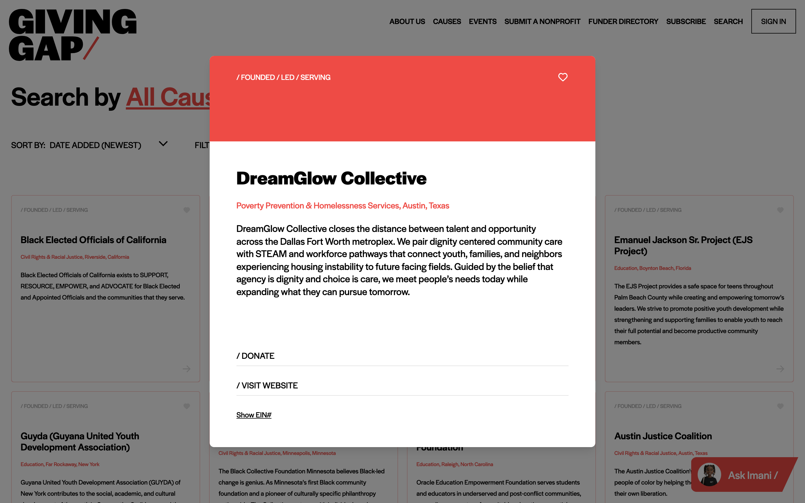
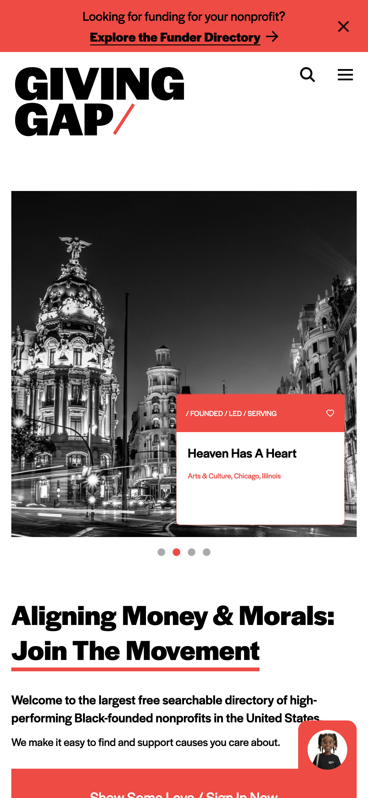

Giving Gap connects donors with more than 2,000 nonprofits. I was the main developer on its website for two years. When the site's frameworks fell past end of life, I rebuilt it from the ground up on Nuxt 4, and that version is now in production.

## The problem

The site ran on Nuxt 2 and Node 14, both past end of life. The code wasn't modular, so every change was slow and hard to make safely. Features the business wanted, like better ways to find organizations, donation processing and an AI chat assistant, sat in the backlog because the old stack couldn't reasonably take them. I maintained the site every day, so I felt that cost directly.

## My role

The upgrade had been on the roadmap for a long time with nobody driving it, so I took it on. I started with a cleanup sprint. I removed an unused feature, stripped out dependencies and plugins nothing used, split a monolithic store into modules and pinned the Node version. That showed how much of the old setup no longer worked. I started the rebuild in my own repo, then brought it into the team's dev branch and on to production. I wrote all of the code over about eight months.

Nuxt 4 came out around the time I started, so I went straight to it rather than stopping at Nuxt 3 and facing another migration soon after.

## How I built it

Most of the difficulty was scale. The old code was hard to read, so much of the work was tracing what lived where, and why it behaved the way it did, before I could replace it.

- **Structure first.** Before building features, I designed the new architecture, an atomic-design component system in TypeScript, with the logic broken into small composables and Pinia stores that each do one job, and a CSS layer built on design tokens.
- **Hydration.** Server-side rendering brought hydration bugs, where the page the server sends doesn't match the one the browser builds. I tracked them down, set up hybrid rendering and made data fetching non-blocking.
- **Authentication.** I rebuilt the Auth0 login and logout flow. A later bug made login fail silently and loop through redirects, and I fixed it by moving callback handling into a dedicated page.
- **Content and SEO.** I rebuilt how CMS content renders, with a Portable Text renderer and a server-side Sanity client, and generated the sitemap and robots.txt from the CMS.
- **Documentation.** I commented the code thoroughly and documented the new codebase, so the next developer could find their way around it.

<video src="/videos/giving-gap/gg-submit-form.mp4" aria-label="Filling out the Giving Gap organization submission form" controls muted playsinline preload="metadata"></video>

## Also on Giving Gap

**Org dashboard.** The Giving Gap team tracked nonprofit applications in a Google Sheet, so I proposed a dashboard to replace it. It started as an admin table for reviewing submissions and setting their status, then grew into a card-based design with a detail page per organization, filters, and user reports with CSV export. Adding Auth0 let nonprofits log in to see their own status alongside the team's admin view.

<video src="/videos/giving-gap/gg-dashboard-record-walkthrough.mp4" aria-label="A walkthrough of an organization record in the Giving Gap dashboard, with details blurred" controls muted playsinline preload="metadata"></video>

**Imani chat assistant.** Given an existing AI backend, I built the whole front end from our designer's rough designs, including the chat interface, the animations for messages coming in and going out, and its mobile layout. I packaged it as a standalone web component, so it can be embedded in the website or the dashboard, or run on its own.

<video src="/videos/giving-gap/gg-imani-chat-mobile.mp4" aria-label="Chatting with the Imani assistant on a phone" controls muted playsinline preload="metadata"></video>

## Outcome

- The rebuilt site is in production at givinggap.org, on supported versions of Nuxt and Node.
- Work the old stack had blocked could be added again, including the Imani chat assistant.
- The dashboard replaced the spreadsheet for the Giving Gap team, and nonprofits logged in to use it.
- The codebase is documented for whoever works on it next.

## What I learned

The further a codebase falls behind, the harder it is to catch up, so small, regular updates beat one big jump. I'd also check in with teammates far more often. Months of working on the rebuild by myself gave me tunnel vision, and someone to review the work with, or just to talk ideas through with, would have helped a lot.
