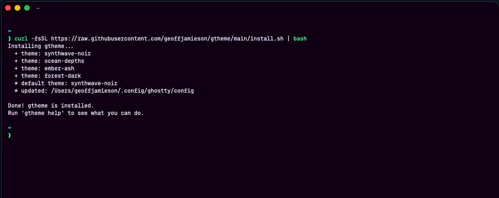
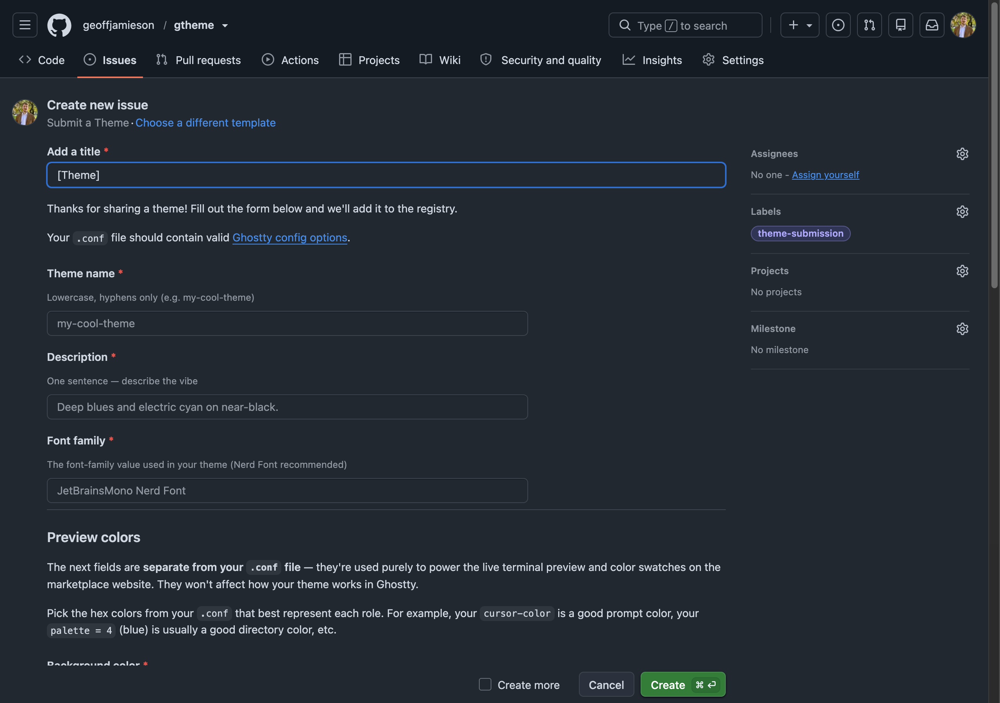
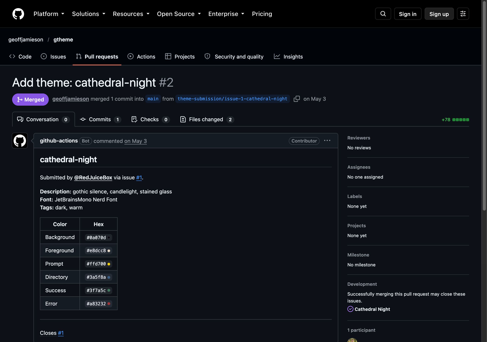
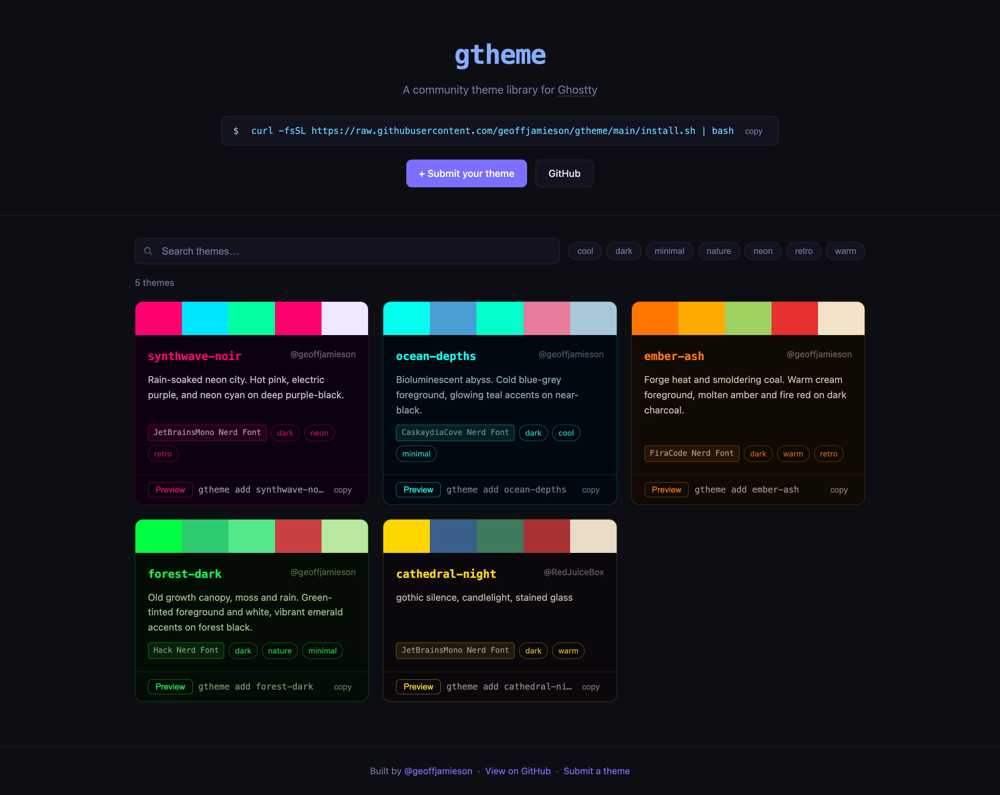
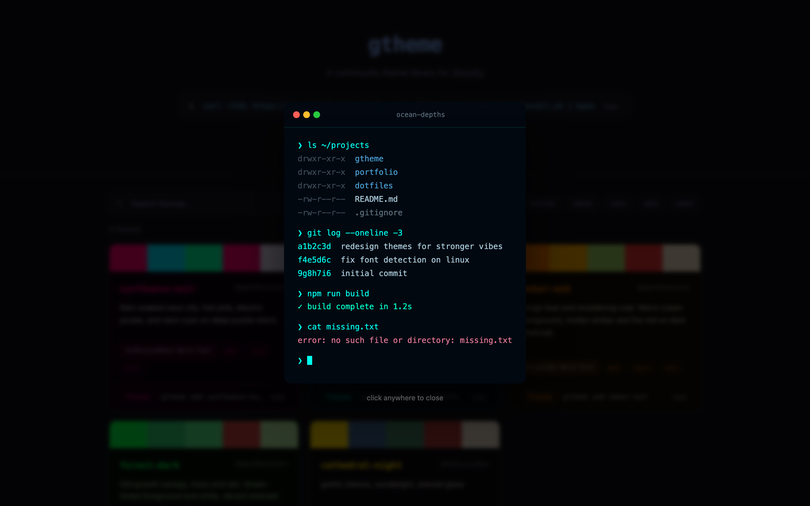

gTheme is an open-source command-line tool for switching themes in the Ghostty terminal. It comes with a marketplace site for browsing themes and a pipeline that turns community theme submissions into pull requests automatically.

## Why I built it

I spend enough of my day in the terminal that I want it to look and feel good, and I'd come to really like Ghostty. Changing its theme meant editing the config file every time, and I wanted to flip between a few favorites instantly and find themes other people had made. Mostly, I wanted to learn how to build something like this, and to see if I could make that experience nicer.

## My role

It's my own project, and I built all of it, using Claude Code throughout. I gave each directory its own `CLAUDE.md` notes, so each session loaded only the context it needed. I wrote the submission script in Python with Claude's help.

## How I built it

- **A CLI in plain Bash.** Commands cover listing themes in an interactive picker, switching, searching, adding, removing, updating and submitting. Themes are plain Ghostty config files, and the active theme is a symlink, so switching is instant with no config editing. A one-line installer sets up the PATH, the tool updates itself, and it warns you when a theme's font isn't installed. There's no server or package manager, since `gtheme add` pulls theme files straight from GitHub.
- **A community submission pipeline.** A GitHub issue form collects a theme's config and six preview colours. A GitHub Actions workflow then validates the submission (name format, duplicates, hex colours), adds the theme to the registry and opens a pull request. When validation fails, it comments on the issue with the reason.
- **A marketplace site.** A single static page in vanilla HTML, CSS and JavaScript, with search, tag filters, a live terminal preview, colour swatches and a copy-to-install button. Each of the four bundled themes has its own designed look.

## Outcome

- Released v1.0.0, with the marketplace live on GitHub Pages.
- Tested the whole pipeline end to end. A theme submitted through the issue form came through as an automated pull request and was merged.

## What I learned

A lot of this was new to me, including building a CLI in Bash, GitHub Actions and issue forms, how a community submission pipeline fits together, and a little Python. It also shaped how I work with AI. I used it through implementation, new features and testing to take the project from an idea to a finished release, instead of asking it to build the whole thing in one go.
