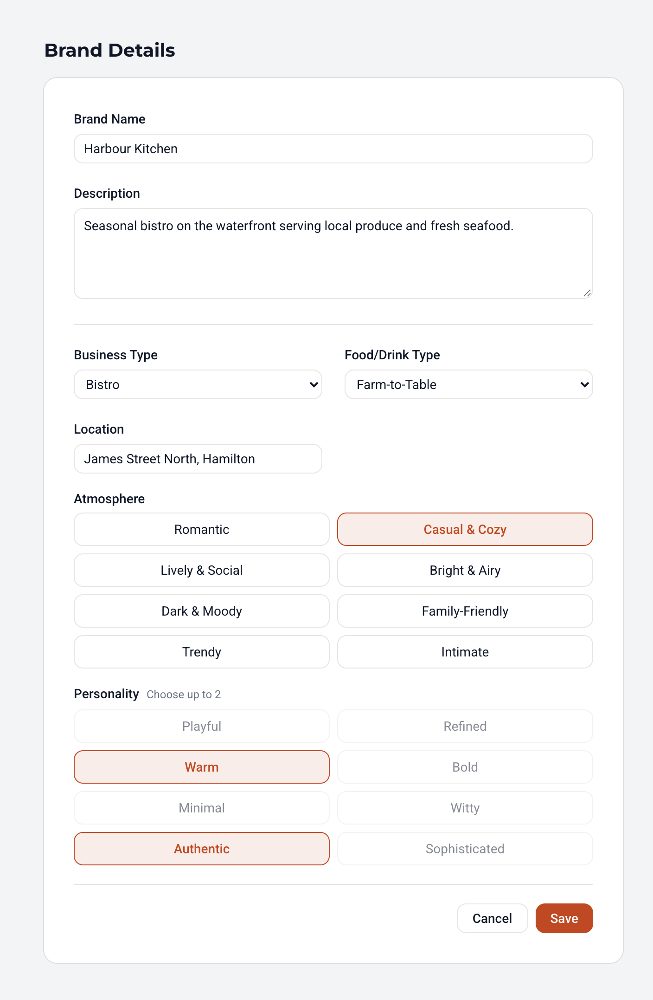
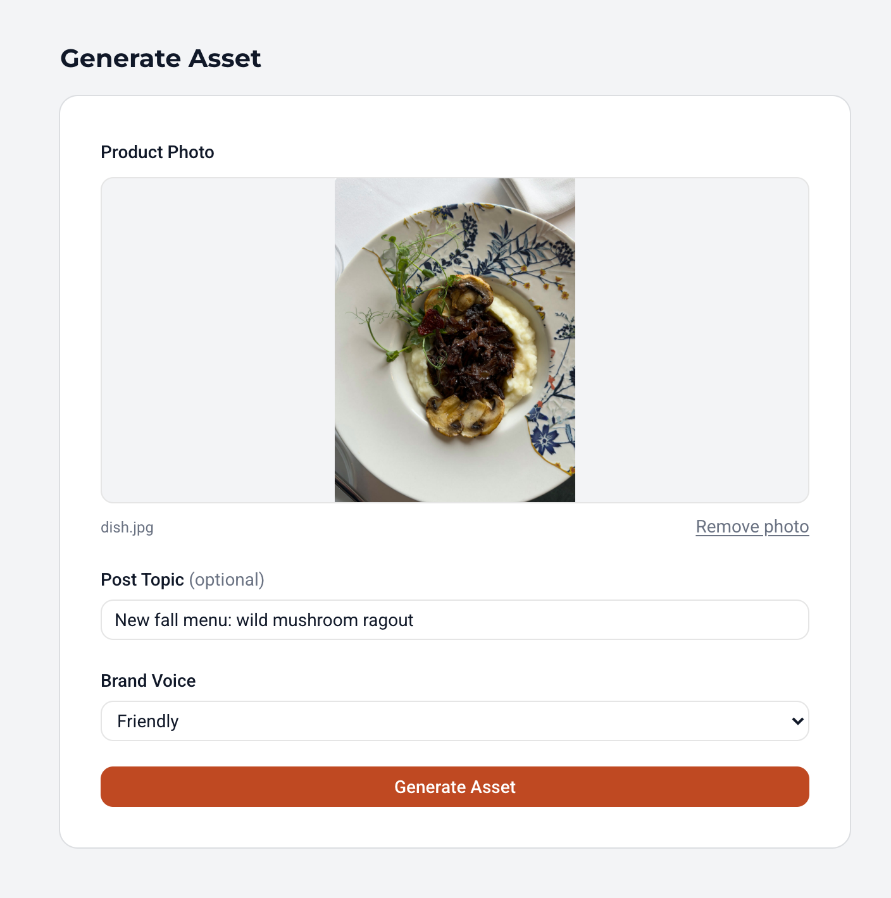
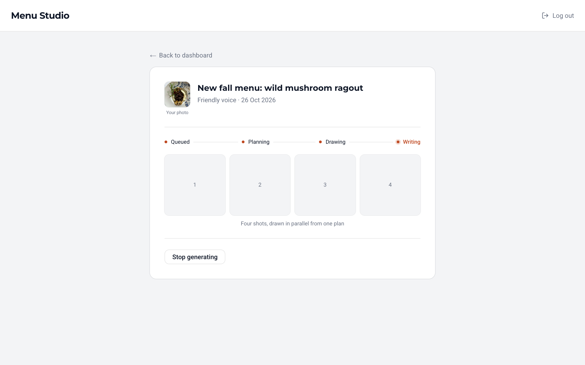
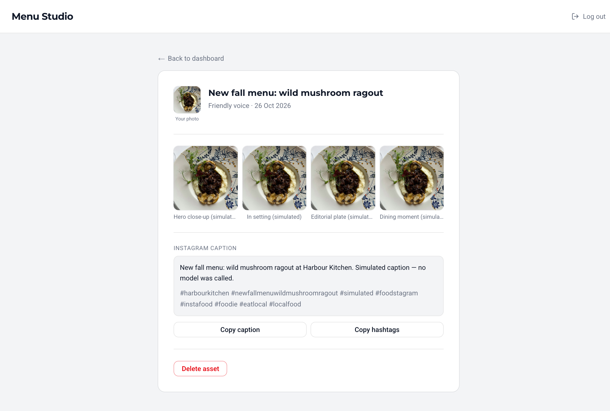
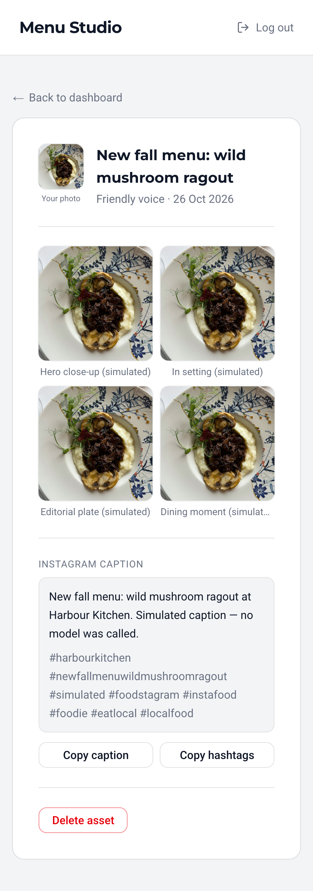

Menu Studio is for restaurants and food businesses without a marketing team. You upload a photo of a dish and get back four campaign images, plus a caption and hashtags. I took it from a prototype that didn't work end to end to a working app in production, built with AI coding tools, with me making the technical decisions, reviewing the code and testing it.

## The problem

The idea was to give food businesses campaign-ready images without a photo shoot for every dish, since a menu of eight dishes can mean around 32 photographs. An early prototype existed, but it didn't work end to end.

## My role

I first worked on the prototype, cleaning up a lot of its code and fixing bugs and security issues, then started over, keeping only the concept. I used AI coding tools to write the code. I decided how each part should work, had it built to that plan, reviewed it and tested everything myself. It took many rounds, and when things broke I debugged them, both the traditional way and with AI, which is much faster when you understand what you're looking at. I also worked through deployment, environment setup and the database's permission edge cases, and documented them.

## How I built it

Generating a campaign takes several AI calls and can fail partway through, so most of my decisions were about making that reliable, and affordable to test.

- **Generation as a background job.** One Claude call plans four distinct shots, four Gemini calls draw the images in parallel, and two more Claude calls write the caption and hashtags. The job runs separately from the request, moving through clear stages (queued, planning, drawing, writing, then complete or failed), so you can watch progress, leave and come back, or cancel.
- **Retries that know the difference.** The job retries temporary failures and stops on permanent ones.
- **A simulate mode.** Generation can run simulated, plan-only or live, so development and testing never spend real money by accident.
- **Direct photo uploads.** Photos go straight from the browser to storage, which gets around the 1 MB limit on requests to the server.
- **Accounts and data.** Supabase handles sign-up, email confirmation and password reset, the Postgres database (with row-level security so each user only sees their own data) and file storage.

## Outcome

- Menu Studio shipped to production as a beta, with internal testers, live demos and food and beverage clients lined up to try it.
- My role ended before clients started using it.

## What I learned

Mostly, how to work with AI well. It showed me how important it is to stay in the loop as the human, making the decisions, understanding the problems and shaping the solution, rather than accepting whatever the AI suggests. A technical background is what makes that possible. I didn't have to write the database schema myself, but knowing what a good one looks like let me ask for a better one. It shaped how I use AI today.

It also taught me a lot about system design and project architecture, and it was my first time using Supabase, which gave me more full-stack experience.
