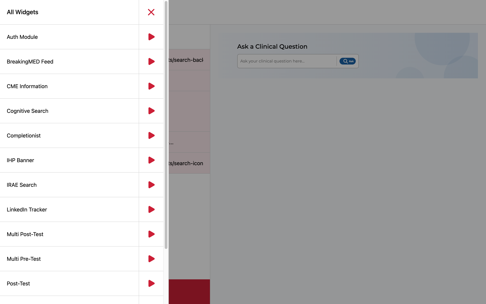
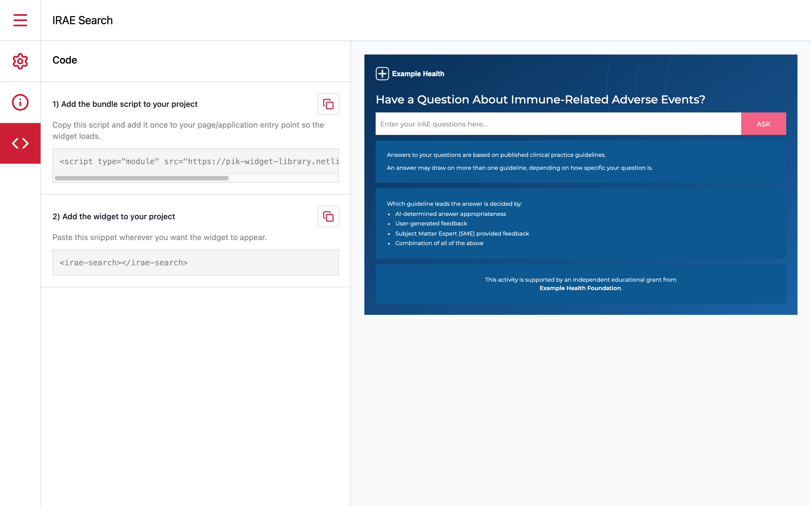
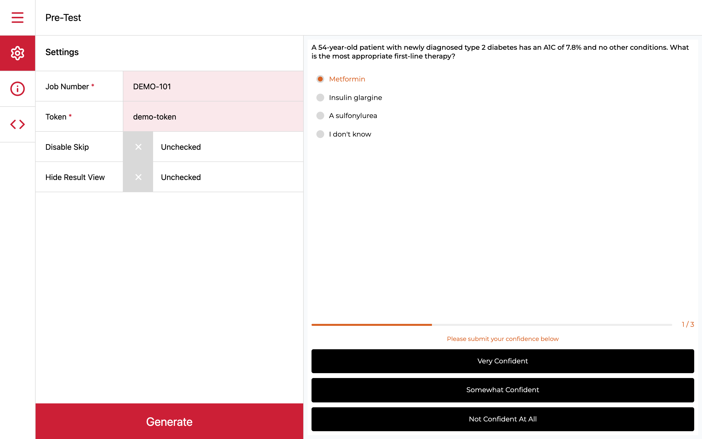
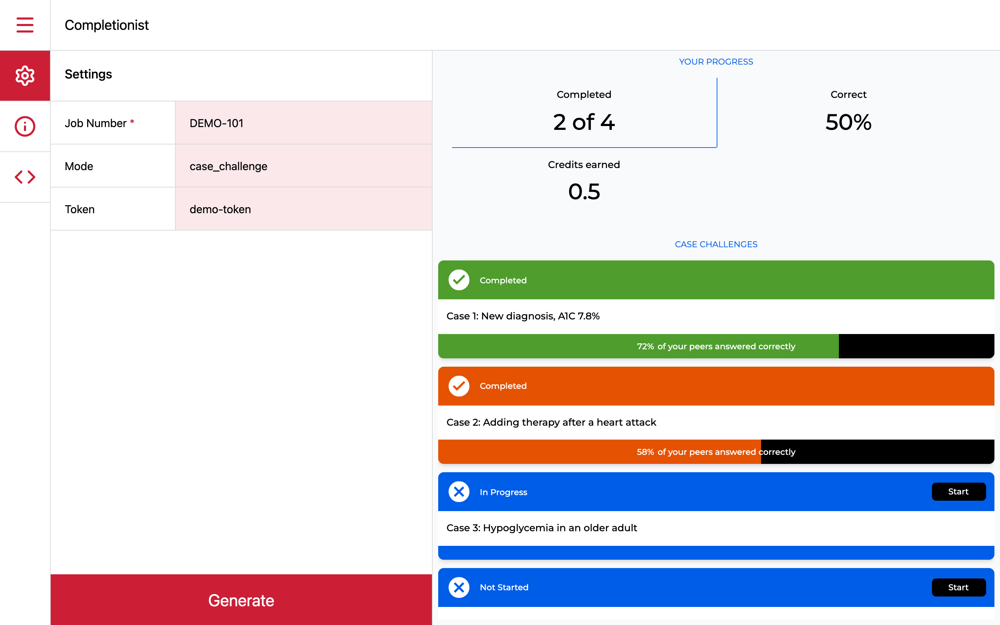
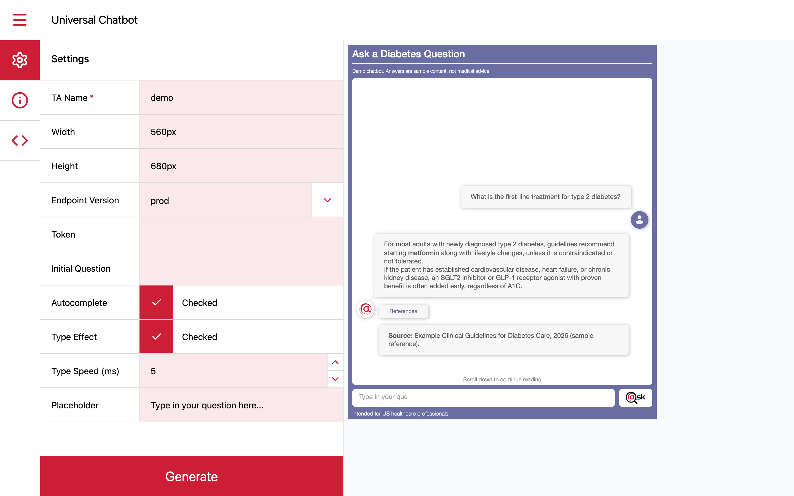

A medical education company embeds small interactive widgets, like pre- and post-tests, search tools and a chatbot, across its websites and products. I turned them into a proper library of 14 widgets, running in production across about eight of the company's products, with a playground and documentation that let other developers build and ship widgets of their own.

## The problem

The widgets lived in a legacy project nobody was maintaining, with their logic spread across several codebases. The client is a large company with many separate teams, and most of their developers couldn't access our repos or didn't know them. So whenever a team needed one of our widgets in their product, or even just a different colour on one, they had to ask us to change it and send it back. Small requests kept landing on my team, and the other developers had to wait on us for every one.

We decided to build a library with every widget in one place. I wanted to go a step further and add a playground, so developers could adjust and export widgets themselves.

## My role

My team lead handed me the project. I built the library from scratch in a fresh repo, then brought it back into the client project. I wrote the code myself and designed how it was structured, documented and shipped.

## How I built it

The hardest part was the playground, and making sure every widget ran correctly in it and in the client's products.

- **A playground for every widget.** Each widget appears in the playground with a form for its content and settings, and a live preview that updates as you edit. When it looks right, you export it as a standalone web component to drop into another product.
- **Widgets that don't interfere with each other.** Each widget gets its own isolated state, so several can run on the same page without stepping on each other.
- **Self-contained by design.** Every widget bundles its own fonts and follows one shared theming system, so it looks right on any host page.
- **Built for distribution.** The library builds as ES modules hosted on Netlify with the right cross-origin settings, so any of the client's sites can load a widget, with environment-based configuration.
- **Documentation.** I wrote general docs on how to build and use a widget, plus a page for every widget, so other developers could work without me.

## Outcome

- 14 widgets running in production across about eight of the client's products and sites.
- Five or six developers used the library, and others built and shipped widgets of their own using the playground and docs.

## What I learned

This was my first deep work with custom elements, and I learned how much comes with them, like keeping each widget's CSS isolated in its own shadow DOM, keeping state separate between widgets, and building and hosting a library for other teams to use, which was new to me.
